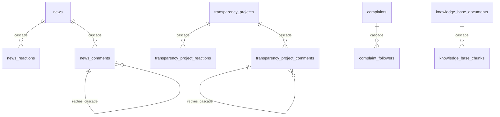

# Database

The portal stores everything except users and files in a Neon Postgres database. The schema is defined with Drizzle ORM in `src/db/schema.ts`, which is the single source of truth for tables, enums and row types. `src/db/config.ts` creates the client over Neon's HTTP driver:

```ts
import { drizzle } from "drizzle-orm/neon-http";
export const db = drizzle(process.env.DATABASE_URL!);
```

The HTTP driver sends one query per request and has no interactive transactions. Where several writes must succeed together, the code uses `db.batch([...])`, which runs as one transaction (see `reorderOfficials`).

## What lives where

| Data | Where |
|---|---|
| Users: name, email, avatar, role, ban status | Clerk. The database stores only Clerk user ids (`varchar(255)`) |
| A last-known copy of each user, for deleted users and Analytics | `user_snapshots`, kept by the Clerk webhook |
| Files | Cloudflare R2. Rows store the object keys in JSON columns |
| Everything else | Postgres |

Because users live in Clerk, no column has a foreign key to a users table. A user id in a row may point to a Clerk user that was since deleted, which the code shows as "Deleted User".

## Keeping the database in sync

Tables are synced with `push`:

```bash
npx drizzle-kit push
```

- **Never run `drizzle-kit generate` or `migrate`.** `drizzle/` holds only a custom migration that enables pgvector (`CREATE EXTENSION IF NOT EXISTS vector`), so `generate` would emit a migration that recreates every table.
- **Apply database changes before or with the schema change.** Drizzle's `select()` names every column in the schema. A column added to `schema.ts` but not yet in the database breaks every query on that table with `column "..." does not exist`.
- **The live database is the owner's call.** `push` asks before destructive changes (dropping columns, changing enum values, adding `NOT NULL` to a column with nulls). Decide with the owner before applying one.
- **Enums.** Most enum value lists are defined as `as const` arrays in `src/schemas/*` (e.g. `COMPLAINT_CATEGORIES`) and passed to `pgEnum`, so the form, the schema and the database share one list. Adding a value is a non-destructive `push`. Renaming or removing one needs the rows using it migrated first.

## Naming

- Table names are snake_case (`document_requests`). Column names are camelCase (`requesterId`) with no casing option, so raw SQL must quote them: `"sortOrder"`, `"createdAt"`.
- Ids are `integer generated always as identity`, except tables keyed by a Clerk user id (`resident_profiles`, `user_snapshots`, `user_preferences`) and the settings singleton.
- `createdAt` and `updatedAt` are `timestamp` without time zone, written with `defaultNow()` or `new Date()` by a server running in UTC, so they hold UTC times.

## Relationships



Those are the only foreign keys. `notifications.referenceId` and `audit_logs.entityId` point to rows in several tables, so they have none, and they're kept when their record is deleted on purpose.

## Tables

### Submissions

The four kinds of resident submission share a shape: a `status` enum, a `handlerId` (the admin who last changed the status, cleared when it goes back to Pending), a reply message with attachments for each closing status (cleared when the status moves away from it), `createdAt` and `updatedAt`.

#### `document_requests`

| Column | Type | Notes |
|---|---|---|
| `id` | integer | Reference number `DR-<id>` |
| `documentType` | `document_request_type` | One of the six document types |
| `requesterId` | varchar | Clerk user id |
| `purpose` | varchar | One of the form's purpose options, or `"Other"` |
| `otherPurpose` | varchar, null | The typed purpose when `purpose` is `"Other"` |
| `situationDescription` | text, null | Indigency, Solo Parent and Medical / Lab Assistance |
| `paymentReceipt` | json `MediaItem[]` | Barangay Clearance's GCash receipt |
| `supportingDocuments` | json `MediaItem[]` | Indigency, Solo Parent and Medical / Lab Assistance |
| `receiveVia` | varchar | `"Pickup at Barangay Hall"` or `"Online Soft Copy"` |
| `preferredClaimAt` | timestamp, null | Only for pickups |
| `status` | `document_request_status` | Default `Pending` |
| `handlerId` | varchar, null | |
| `pickupMessage`, `pickupAttachments` | text, json | Set with Ready for Pickup, kept through Claimed |
| `rejectionReason`, `rejectionAttachments` | text, json | Set with Rejected |
| `claimedAt` | timestamp, null | Only while Claimed |

#### `complaints`

| Column | Type | Notes |
|---|---|---|
| `id` | integer | Reference number `CP-<id>` |
| `complainantId` | varchar | Clerk user id |
| `subject`, `description` | varchar, text | |
| `location` | json `LocationValue` | Required |
| `evidence` | json `MediaItem[]` | Up to 5 files |
| `category` | `complaint_category` | Suggested by AI when filed |
| `priority` | `complaint_priority` | Suggested by AI when filed |
| `status` | `complaint_status` | Default `Pending` |
| `handlerId` | varchar, null | |
| `resolutionMessage`, `resolutionAttachments` | text, json | Set with Resolved |
| `dismissalReason`, `dismissalAttachments` | text, json | Set with Dismissed |
| `aiInsight` | json `ComplaintAiInsight`, null | Admin-generated response plan |

#### `complaint_followers`

Residents who confirmed, while filing, that an existing complaint is the same issue as theirs.

| Column | Type | Notes |
|---|---|---|
| `id` | integer | |
| `complaintId` | integer | FK to `complaints`, cascade |
| `userId` | varchar | The follower |
| `createdAt` | timestamp | |

Unique on (`complaintId`, `userId`).

#### `court_reservations`

| Column | Type | Notes |
|---|---|---|
| `id` | integer | Reference number `CR-<id>` |
| `requesterId` | varchar | |
| `date` | date | Returned as a `"YYYY-MM-DD"` string |
| `startTime` | integer | Minutes after midnight, 0–1439 |
| `durationHours` | integer | Whole hours. `startTime + durationHours * 60` is at most 1440 |
| `purpose` | varchar | |
| `totalAmount` | numeric(10, 2) | Computed by the server at creation. Returned as a string |
| `gcashPayment` | json `MediaItem[]` | Empty for admin reservations |
| `status` | `court_reservation_status` | Default `Pending`. Admin reservations start `Approved` |
| `handlerId` | varchar, null | |
| `rejectionReason`, `rejectionAttachments` | text, json | |

#### `businesses`

| Column | Type | Notes |
|---|---|---|
| `id` | integer | Reference number `CH-<id>` |
| `name`, `description` | varchar, text | |
| `category` | `business_category` | |
| `contactNumber` | varchar(20) | |
| `socialMediaLink` | varchar, null | |
| `operatingHours` | json `OperatingHours` | |
| `photos` | json `MediaItem[]` | Up to 10 |
| `permit` | json `MediaItem[]` | Exactly one, seen only by the owner and admins |
| `location` | json `LocationValue`, null | Businesses without one don't appear on the map |
| `ownerId` | varchar | |
| `status` | `business_status` | Default `Pending`. Admin submissions start `Verified` |
| `handlerId` | varchar, null | |
| `rejectionReason`, `rejectionAttachments` | text, json | |

A resident's edit resets `createdAt` to the edit time, so the resubmission sorts as new in the admin's list.

### Posts

#### `news`

| Column | Type | Notes |
|---|---|---|
| `id` | integer | |
| `title` | varchar | |
| `category` | `news_category` | |
| `content` | text | |
| `media` | json `MediaItem[]` | Images and videos shown in the card's gallery |
| `attachments` | json `MediaItem[]` | Documents listed under the post |
| `pinned` | boolean | Pinned posts sort first |
| `authorId` | varchar | |

#### `news_reactions`, `transparency_project_reactions`

One row per user per post: `id`, `newsId` / `projectId` (FK, cascade), `userId`, `type` (`like` or `dislike`), `createdAt`. Unique on (post, user). Reacting again with the same type removes the row, and the other type switches it.

#### `news_comments`, `transparency_project_comments`

`id`, `newsId` / `projectId` (FK, cascade), `parentId` (self-reference, cascade, null for top-level), `userId`, `content`, `createdAt`. Replies go one level deep: `addNewsComment` refuses to reply to a reply. Deleting a comment deletes its replies.

#### `transparency_projects`

| Column | Type | Notes |
|---|---|---|
| `id` | integer | |
| `title` | varchar | |
| `category` | `transparency_category` | |
| `description` | text | |
| `budget` | numeric(12, 2), null | Returned as a string, e.g. `"1500.00"` |
| `location` | json `LocationValue`, null | |
| `media`, `attachments` | json `MediaItem[]` | |
| `authorId` | varchar | |

### People

#### `resident_profiles`

A resident's Resident Credentials, keyed by Clerk user id.

| Column | Type | Notes |
|---|---|---|
| `userId` | varchar, primary key | |
| `firstName`, `middleName`, `lastName` | varchar | First and last name are also written to Clerk on save |
| `birthdate` | date | |
| `sex` | `resident_sex` | |
| `civilStatus` | `resident_civil_status` | |
| `contactNumber` | varchar(20) | 11 digits |
| `address` | text | |
| `validIdType` | `resident_valid_id_type` | |
| `validIdFront` | json `MediaItem[]` | Required |
| `validIdBack` | json `MediaItem[]` | Optional |

#### `user_snapshots`

A mirror of each Clerk user, kept by `/api/webhooks/clerk` and `npm run backfill:user-snapshots`. Clerk's `user.deleted` event carries only the id, so this is where a deleted user's name and email are still known.

| Column | Type | Notes |
|---|---|---|
| `userId` | varchar, primary key | |
| `fullName`, `email` | varchar | |
| `role` | varchar(32), null | `admin`, `superadmin` or null |
| `joinedAt` | timestamp | Clerk's `created_at`. Analytics counts new users by it |
| `updatedAt` | timestamp | |
| `deletedAt` | timestamp, null | Set when the user is deleted from Clerk |

#### `user_preferences`

`userId` (primary key), `theme` (`theme_preference`, default `light`), `updatedAt`. Lets the dark-mode choice follow the user across devices.

### Barangay

#### `barangay_settings`

A singleton row with `id = 1`. `getBarangaySettings()` returns the defaults from `src/lib/data.ts` when the row doesn't exist, and `updateBarangaySettings` upserts it.

| Column | Type | Notes |
|---|---|---|
| `id` | integer, default 1 | Always 1 |
| `gcashNumber` | varchar(20) | Shown on the clearance and court reservation forms |
| `clearancePurposeFees` | json `ClearancePurposeFees` | Fee per paid clearance purpose |
| `courtDayRate`, `courtNightRate` | integer | Pesos per hour |
| `goal`, `mission`, `vision` | text | |
| `hotline1`, `hotline2` | varchar(20) | `hotline2` is `""` when there's only one |
| `email` | varchar | |
| `address` | text | |
| `updatedAt` | timestamp | |

#### `officials`

| Column | Type | Notes |
|---|---|---|
| `id` | integer | |
| `section` | `official_section` | `barangay` or `sk` |
| `name`, `position` | varchar | |
| `photo` | json `MediaItem[]` | One photo |
| `sortOrder` | integer | Order within the section, set by dragging. Ties fall back to `id` |

### System

#### `notifications`

| Column | Type | Notes |
|---|---|---|
| `id` | integer | |
| `userId` | varchar | The recipient |
| `type` | `notification_type` | Which kind of submission |
| `referenceId` | integer | The submission's id. No FK |
| `status` | varchar(64) | The new status, or `"Deleted"` |
| `message` | text | Snapshot, e.g. `Your Barangay Clearance request is now Ready for Pickup.` |
| `readAt` | timestamp, null | |
| `createdAt` | timestamp | |

Indexed on (`userId`, `createdAt`).

#### `push_subscriptions`

One row per browser that turned on phone notifications (see [Notifications](features/notifications.md#phone-notifications)). A browser belongs to the user who last opened the portal in it.

| Column | Type | Notes |
|---|---|---|
| `id` | integer | |
| `userId` | varchar | Who gets the pushes. Indexed |
| `endpoint` | text, unique | The push service URL that identifies the browser |
| `p256dh`, `auth` | text | The browser's keys for encrypting the payload |
| `createdAt` | timestamp | |

Rows are deleted when the push service reports the subscription gone (404/410), when the user turns phone notifications off, and when the user is deleted.

#### `audit_logs`

| Column | Type | Notes |
|---|---|---|
| `id` | integer | |
| `actorId` | varchar | The admin who acted |
| `actorRole` | varchar(32), null | Their role at the time |
| `action` | varchar(32) | An `AuditAction` (`src/lib/audit-logs.ts`) |
| `entityType` | varchar(32) | An `AuditEntityType` |
| `entityId` | varchar | The record's id, a Clerk user id for `user`, or the section for a reorder |
| `summary` | text | One line, e.g. `Changed DR-12 (Barangay Clearance) from Pending to Rejected` |
| `changes` | json `AuditChange[]` | Field values before and after, as display text |
| `createdAt` | timestamp | |

Indexed on `createdAt`. `action` and `entityType` are varchar rather than enums so new kinds need no database change. Entries are never edited or deleted.

#### `knowledge_base_documents`, `knowledge_base_chunks`

| Table | Columns |
|---|---|
| `knowledge_base_documents` | `id`, `fileName`, `fileKey` (the PDF in R2), `chunkCount`, `uploadedBy`, `createdAt` |
| `knowledge_base_chunks` | `id`, `documentId` (FK, cascade), `chunkIndex`, `content`, `embedding vector(1536)`, `createdAt` |

The chat ranks chunks by cosine distance in Postgres. The vector size comes from `KNOWLEDGE_BASE_EMBEDDING_DIMENSIONS` in `src/lib/ai-assistant/knowledge-base.ts`. Changing the embedding model means changing the column's dimensions in the database and re-uploading every document.

## Enums

| Enum | Values | Defined in |
|---|---|---|
| `document_request_type` | Barangay Clearance, Certificate of Residency, Certificate of No Objection, Certificate of Indigency, Solo Parent Certification, Medical / Lab Assistance | `schema.ts` |
| `document_request_status` | Pending, Processing, Ready for Pickup, Claimed, Rejected | `schema.ts` |
| `complaint_category` | Noise, Sanitation, Public Safety, Traffic, Infrastructure, Water/Electricity, Domestic, Environment, Others | `COMPLAINT_CATEGORIES` |
| `complaint_priority` | Low, Medium, High, Urgent | `COMPLAINT_PRIORITIES` |
| `complaint_status` | Pending, In Progress, Resolved, Dismissed | `COMPLAINT_STATUSES` |
| `court_reservation_status` | Pending, Approved, Rejected | `COURT_RESERVATION_STATUSES` |
| `business_category` | Food & Beverage, Retail, Services, Health & Wellness, Beauty & Personal Care, Education, Automotive, Agriculture, Technology, Others | `BUSINESS_CATEGORIES` |
| `business_status` | Pending, Processing, Verified, Rejected | `BUSINESS_STATUSES` |
| `news_category` | Announcement, Event, Emergency | `schema.ts` |
| `news_reaction_type`, `transparency_reaction_type` | like, dislike | `schema.ts` |
| `transparency_category` | Infrastructure, Health, Education, Livelihood, Social Welfare, Peace and Order, Environment, Others | `TRANSPARENCY_CATEGORIES` |
| `official_section` | barangay, sk | `schema.ts` |
| `resident_sex` | Male, Female | `SEX_OPTIONS` |
| `resident_civil_status` | Single, Married, Live-in, Widowed, Annulled, Separated | `CIVIL_STATUS_OPTIONS` |
| `resident_valid_id_type` | National ID, TIN, Pag-IBIG, Police Clearance, NBI Clearance | `VALID_ID_TYPES` |
| `notification_type` | document-request, community-hub, court-reservation, complaint | `schema.ts` |
| `theme_preference` | light, dark | `schema.ts` |

Most tables export a row type (`export type Complaint = typeof complaintsTable.$inferSelect`), and enum values are read in code as `complaintStatusEnum.enumValues` or `Complaint["status"]`.

## JSON column shapes

| Type | Defined in | Shape |
|---|---|---|
| `Omit<MediaItem, "file">` | `src/components/file-uploader.tsx` | `{ key?: string; name: string; type: "image" \| "video" \| "document"; size?: number; contentType?: string }`. `key` is the R2 object key |
| `LocationValue` | `src/components/map-picker.tsx` | `{ coordinates: { lat: number; lng: number }; address: string }`. `address` is `""` when reverse geocoding failed |
| `OperatingHours` | `src/schemas/business-schema.ts` | `{ days: ("Mon" \| … \| "Sun")[]; opens: "HH:MM"; closes: "HH:MM" }`. A closing time at or before the opening time runs past midnight |
| `ClearancePurposeFees` | `src/lib/data.ts` | `{ "Clearance for Local Employment": number; "Bank / Loan Requirements": number; "Business Clearance": number }` |
| `ComplaintAiInsight` | `src/schemas/complaint-schema.ts` | `{ budgetEstimate, estimatedManpower, estimatedTimeframe, suggestedSolution, preventionAdvice: string; requiredResources: string[]; publicSafetyRisk: "None" \| "Low" \| "Medium" \| "High" }` |
| `AuditChange` | `src/lib/audit-logs.ts` | `{ label: string; from: string \| null; to: string \| null }` |

JSON columns aren't validated by the database. The server actions write them from typed inputs.

## Gotchas

- `numeric` columns (`totalAmount`, `budget`) come back as strings. Convert with `Number(...)` before doing arithmetic, and write them with `.toString()`.
- `date` columns (`court_reservations.date`, `resident_profiles.birthdate`) come back as `"YYYY-MM-DD"` strings. Parse them as local days (``new Date(`${date}T00:00:00`)`` or `parseDateValue`), not with `new Date(date)`, which reads UTC midnight.
- `json()` isn't `jsonb`, so you can't index or query inside these columns efficiently. The code never does: it reads whole rows and works in memory.
- Distances (similar complaints, nearest businesses) are computed in memory with the haversine formula (`distanceInMeters`, `src/lib/geolocation.ts`). The barangay is small enough that this stays cheap.
